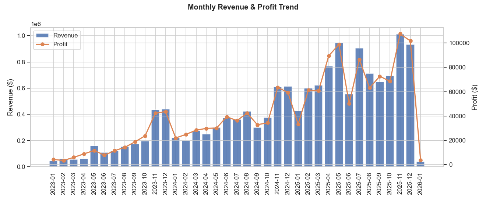
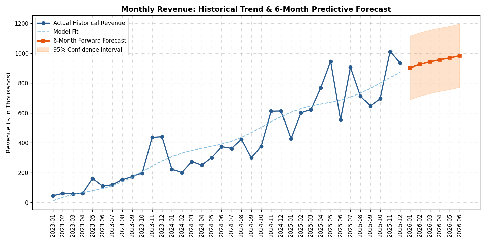
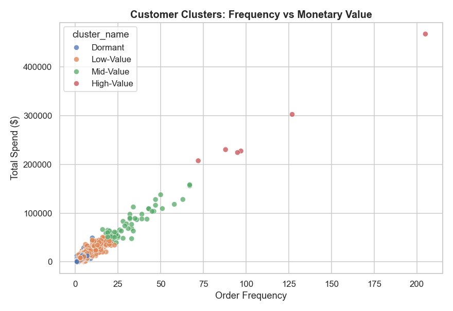
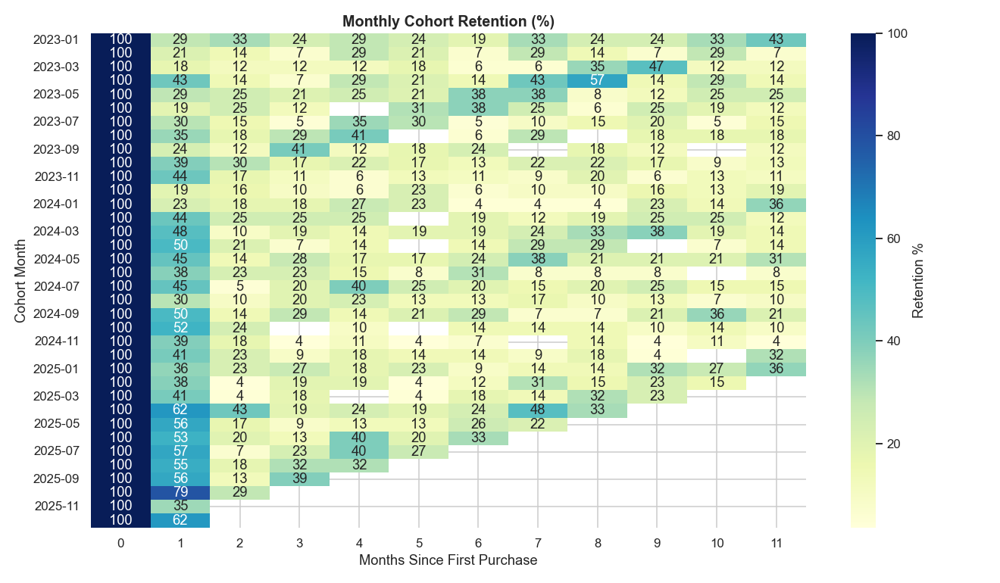
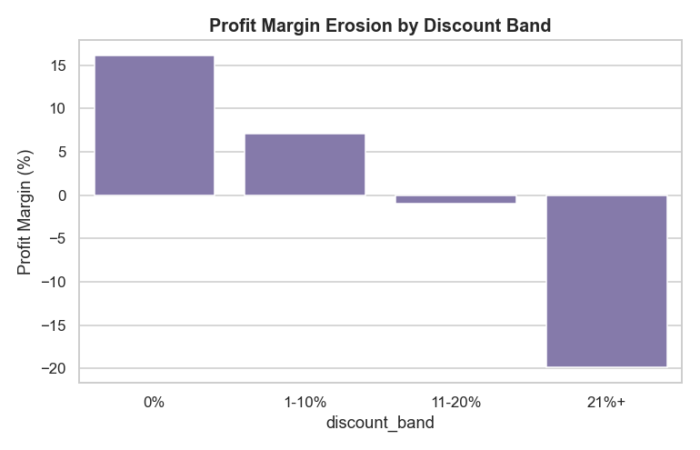
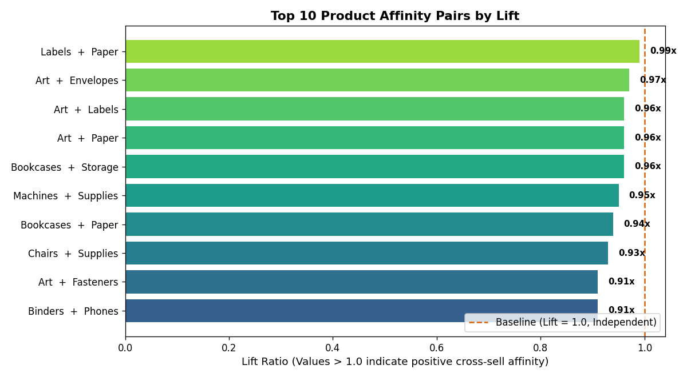

# E-Commerce Sales & Customer Analytics Pipeline
**SQL · Python · Power BI — Production-Grade Data Analytics Portfolio**


-brightgreen)

A comprehensive, end-to-end analytics and business intelligence pipeline built on e-commerce transaction data: normalized relational SQL modeling, programmatic QA checks, exploratory data analysis, dual customer segmentation (rule-based RFM + unsupervised K-Means clustering), cohort retention decay, time-series revenue forecasting, market basket product association, and a Power BI star-schema reporting model.

> **Dataset note:** Built on a normalized transactional dataset matching the industry-standard "Superstore" schema (customers, products, orders, order items, returns) with realistic holiday seasonality, price discounting dynamics, Pareto customer spend concentration, and return behavior. Fully schema-compatible with the Kaggle Superstore or Brazilian Olist datasets.

---

## 📁 Repository Structure

```
ecommerce_project/
├── data/                         # Relational data files & database
│   ├── clean/analysis_ready.csv  # Denormalized table for analysis
│   ├── dim_customers.csv         # 800 customers across 4 regions & 3 segments
│   ├── dim_products.csv          # 216 SKUs across Technology, Furniture, Office Supplies
│   ├── fact_orders.csv           # 6,500 orders (2023–2025)
│   ├── fact_order_items.csv      # 12,920 order line items
│   ├── fact_returns.csv          # Return logs (~5.5% return rate)
│   ├── customer_segments.csv     # RFM scores & K-Means cluster assignments
│   ├── cohort_retention.csv      # Monthly retention decay matrix
│   ├── revenue_forecast.csv      # 6-month projected revenue & confidence intervals
│   ├── market_basket_rules.csv   # Association rules (Support, Confidence, Lift)
│   └── ecommerce.db              # Pre-indexed SQLite database
├── sql/
│   ├── 01_schema.sql             # Table DDL, keys, indexes, and checks
│   └── 02_analysis_queries.sql   # 14 business queries (YoY LAG, CTEs, window functions)
├── python/
│   ├── generate_data.py          # Synthetic dataset generator
│   ├── run_sql_analysis.py       # Automated runner for all 14 SQL business queries
│   ├── 01_data_cleaning_eda.py   # Referential integrity validation & EDA charts
│   ├── 02_customer_segmentation.py# RFM quintiles, K-Means clustering & cohort matrix
│   ├── 03_revenue_forecasting.py # Trend + seasonal time-series forecast with CIs
│   └── 04_market_basket_analysis.py# Multi-item basket association & cross-sell lift
├── tests/
│   └── test_data_pipeline.py     # Automated data quality & integrity test suite
├── outputs/                      # 11 generated high-resolution analytical charts
├── powerbi/
│   ├── data_model/               # Star-schema CSVs ready to import (dim_date, fact_sales...)
│   └── POWERBI_GUIDE.md          # Relationships, cardinality, DAX measures & page designs
├── PROJECT_REPORT.md             # In-depth executive business report & methodology
└── requirements.txt
```

---

## 📊 Key Executive Findings

| Metric | Value | Business Takeaway |
|---|---|---|
| **Total Revenue** | **$15.20M** | Driven by strong Q4 holiday seasonality (~2.2x bump in Nov–Dec) |
| **Total Profit** | **$1.54M** | Overall 10.1% profit margin |
| **Total Orders** | **6,500** | Distributed across 764 unique customers |
| **Average Order Value** | **$2,338** | Highest in Consumer and Corporate segments |
| **Return Rate** | **5.49%** | Highest in Furniture category (5.65%) |
| **Repeat Purchase Rate** | **89.14%** | 681 out of 764 customers placed multiple orders |
| **Discount Threshold** | **20%** | Discounts >20% deeply compress margins into negative territory (-19.9%) |

---

## 📈 Visual Analytics Gallery

### 1. Sales Performance & Predictive Forecasting
| Monthly Trend & Margins | 6-Month Forward Revenue Forecast |
| :---: | :---: |
|  |  |

### 2. Customer Segmentation & Cohort Retention
| Customer Clusters (K-Means) | Cohort Retention Decay Matrix |
| :---: | :---: |
|  |  |

### 3. Business Drivers & Pricing Strategy
| Discount vs. Margin Erosion | Top Cross-Sell Affinity Pairs |
| :---: | :---: |
|  |  |

---

## 🔧 How to Reproduce

```bash
# 1. Set up isolated environment
python -m venv .venv
source .venv/bin/activate       # On Windows: .venv\Scripts\activate
pip install -r requirements.txt

# 2. Run automated test suite
python -m unittest tests/test_data_pipeline.py

# 3. Execute all 14 SQL business queries
python python/run_sql_analysis.py

# 4. Run Python exploratory analysis & segmentation
python python/01_data_cleaning_eda.py
python python/02_customer_segmentation.py

# 5. Run revenue forecast & market basket analysis
python python/03_revenue_forecasting.py
python python/04_market_basket_analysis.py

# 6. Power BI Layer
# Open Power BI Desktop → Get Data → Text/CSV → import files in powerbi/data_model/
# Follow powerbi/POWERBI_GUIDE.md to wire relationships and add DAX measures
```

---

## 🧠 Technical Highlights

* **SQL:** Window functions (`LAG`, `NTILE`, `RANK`), multi-step CTEs, calendar date arithmetic, subqueries, and pure SQL RFM customer scoring.
* **Python (`pandas`, `scikit-learn`, `seaborn`):** Referential integrity checks, feature scaling with `StandardScaler`, K-Means clustering with Elbow Method evaluation, cyclical trigonometric feature engineering (`sin`/`cos`), and association rule mining (`Support`, `Confidence`, `Lift`).
* **Power BI:** Star-schema architecture, dedicated date dimension (`dim_date`), DAX time-intelligence (`SAMEPERIODLASTYEAR`, `TOTALMTD`), and customer lifetime value measures.
* **Data Engineering & Testing:** Unit tests verifying primary/foreign keys, orphan prevention, and non-negative constraints.
